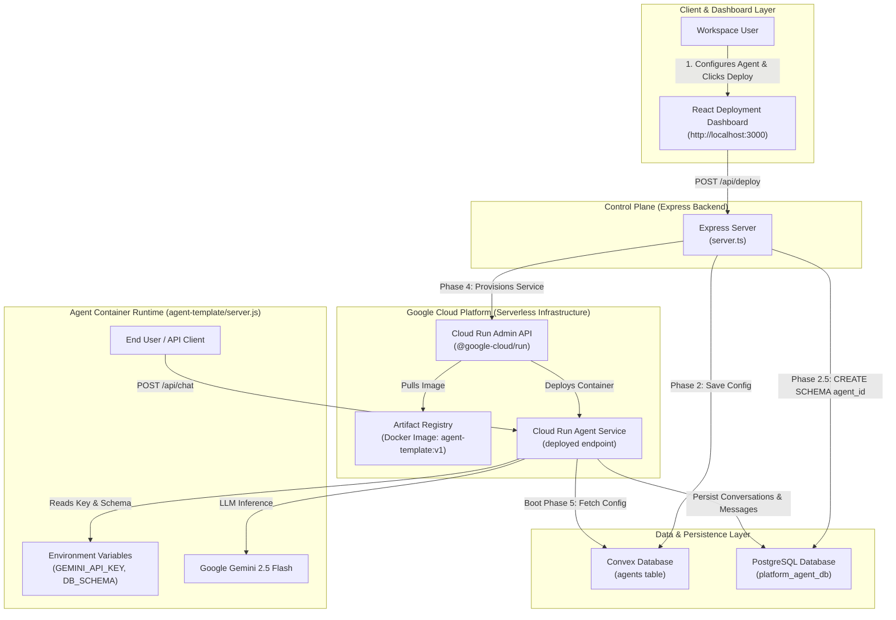
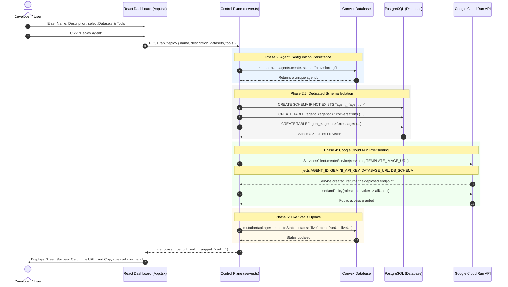
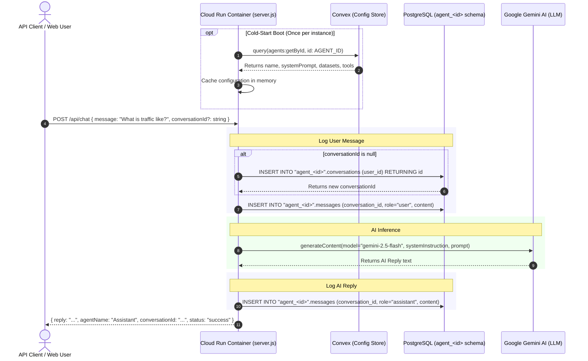
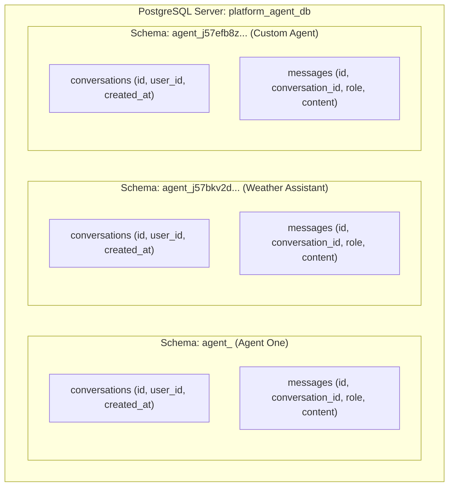

# Agent Deployment Console Architecture & Flowchart

This document illustrates the architecture and execution flows for the Agent Deployment Console prototype.

---

## 1. High-Level System Architecture

---

## 2. End-to-End Agent Deployment Pipeline Flowchart

This flowchart shows the 6-phase pipeline that executes when a user clicks **Deploy Agent**:

---

## 3. Runtime Chat Execution & Message Persistence Flowchart

Once deployed, the agent service runs independently on Google Cloud Run:

---

## 4. Multi-Tenant Isolation Model

### Key Architectural Benefits:
1. **Zero Cross-Contamination**: Each agent can only write and read from its own schema (`DB_SCHEMA`).
2. **Instant Deletion**: Deleting an agent drops only that specific schema (`DROP SCHEMA "agent_<id>" CASCADE;`) without table locking or migration overhead.
3. **10-15s Provisioning Speed**: Because the Golden Image (`agent-template:v1`) is already in Artifact Registry, Cloud Run provisions instantly without compiling source code.
